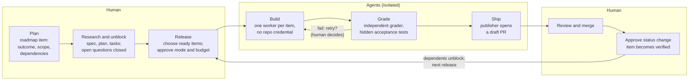
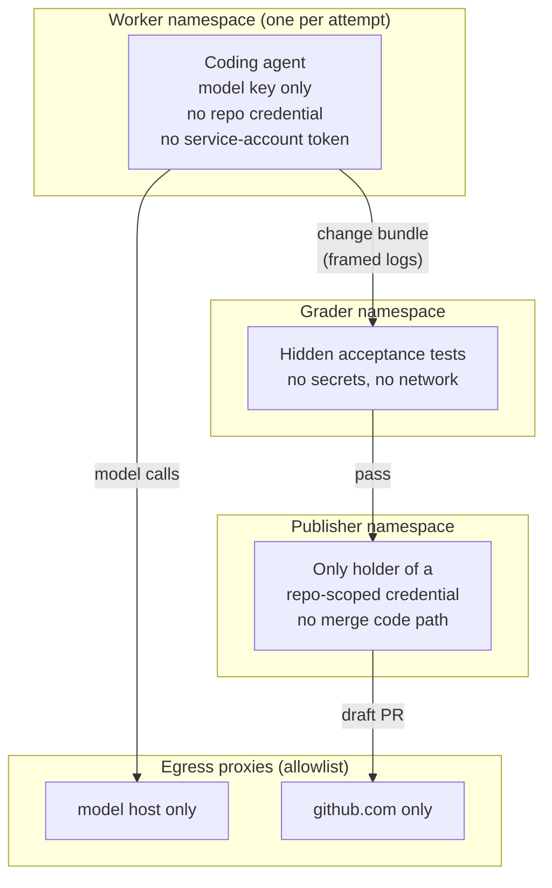
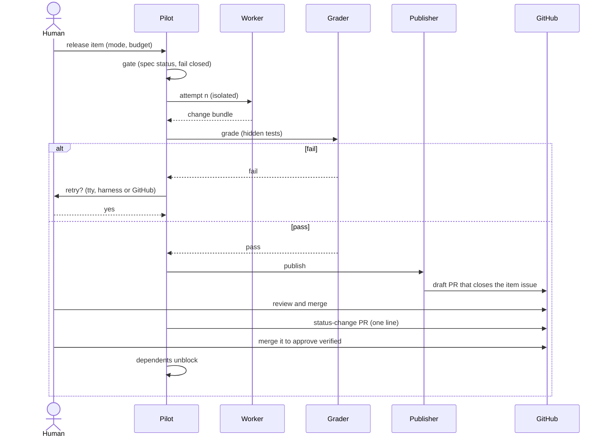
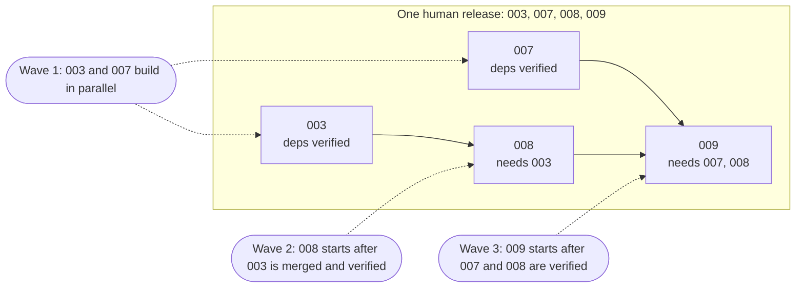

# The approach: humans plan, agents build

specfoundry splits software delivery between people and coding agents along one line:
**humans decide what gets built and when, and agents build only what a human released.**
This document describes that process, and the external research and industry practice
behind each part of it. It also says where the evidence is thin.

**Contents:**
1. [The process in one picture](#1-the-process-in-one-picture)
2. [The problem: faster code is not faster delivery](#2-the-problem-faster-code-is-not-faster-delivery)
3. [Principle 1: humans plan, research and release](#3-principle-1-humans-plan-research-and-release)
4. [Principle 2: agents build in isolation, with least privilege](#4-principle-2-agents-build-in-isolation-with-least-privilege)
5. [Principle 3: humans approve and merge; evidence decides "done"](#5-principle-3-humans-approve-and-merge-evidence-decides-done)
6. [Principle 4: parallel waves, in dependency order, within review capacity](#6-principle-4-parallel-waves-in-dependency-order-within-review-capacity)
7. [Existing and new projects](#7-existing-and-new-projects)
8. [Where each principle lives in the project](#8-where-each-principle-lives-in-the-project)
9. [Limits and open questions](#9-limits-and-open-questions)
10. [Sources](#10-sources)

---

## 1. The process in one picture

| Phase | Who | Roadmap status |
|---|---|---|
| Plan | Human | `planned` |
| Research and unblock | Human (agents may assist while a human drives them) | `specced` |
| Release | Human | released |
| Build, grade, ship | Agents, each in its own isolated unit | `in-progress` |
| Review and merge; approve the status change | Human | `verified` |

An item is **ready for agents** only when a human made it so:
- a spec and a task list exist;
- every dependency is verified, or is released in the same set;
- no open questions remain;
- a human released it.

The pilot never picks up an item on its own, never writes specs, and changes the roadmap only
through a status change a human approves (roadmap constraint C-12).

---

## 2. The problem: faster code is not faster delivery

Several independent sources found that AI assistance raises individual output but does not,
by itself, speed up delivery. Some found it hurts.

- **A randomized controlled trial on mature codebases.** METR assigned 246 real tasks, done by
  16 experienced open-source developers in repositories they knew well, at random to "AI
  allowed" or "AI not allowed". With AI allowed, tasks took **19% longer**. The developers had
  expected a 24% speed-up, and afterwards still believed AI had saved them about 20%. The
  authors caution that the sample is small and the tools were from early 2025. [1]
- **Delivery metrics at scale.** The 2024 DORA report (over 39,000 respondents) associated
  higher AI adoption with an estimated **1.5% drop in delivery throughput** and a **7.2% drop
  in delivery stability**. [2] The 2025 DORA report (about 5,000 respondents) describes AI as
  an **amplifier**: it strengthens teams with good practices and exposes the weaknesses of the
  rest. It names version control, code review discipline and platform engineering as
  prerequisites. [3]
- **The bottleneck moves to review.** Telemetry from over 10,000 developers (Faros AI, a
  vendor) found teams with high AI adoption merged **98% more PRs**, while **review time rose
  91%** and PR size rose 154%. Company-level delivery showed no significant change. [4]

**What this means for the design.** Agent capacity is not the constraint. Three things are:
1. **The quality of what agents are asked to build:** a clear, prepared spec.
2. **Isolation and permissions,** so that a fast agent can't do fast damage.
3. **Human review capacity,** where the work now queues.

The four principles below each address one of these.

---

## 3. Principle 1: humans plan, research and release

The work agents do well is the work that comes with a clear specification. Deciding *what* to
build, in *what order*, with *which trade-offs*, is judgment that stays with people.

- **Spec-driven development.** GitHub's Spec Kit makes the specification the centre of the
  process: the spec drives the plan, the tasks and the implementation. [5] Thoughtworks
  placed spec-driven development in the *Assess* ring of its Technology Radar (November 2025).
  It noted that teams were experimenting with Spec Kit, and warned that some workflows produce
  long specs that are hard to review. [6] specfoundry builds on Spec Kit: the roadmap, spec,
  plan and tasks are the human-owned inputs, and `spec status` reads them deterministically.
- **Predictable paths where predictability matters.** Anthropic's guidance on building agents
  separates *workflows* (predefined code paths around model calls) from *agents* (models
  directing their own steps). It recommends the simplest pattern that works, stopping
  conditions, and pausing for human feedback at checkpoints. [7] specfoundry is deliberately
  a workflow on the outside: gate, build, grade, publish. The agent's freedom is limited to
  the inside of one isolated build.
- **Release as a decision.** A roadmap naturally contains items that block other items. The
  human resolves blockers, by research or by merging prerequisites, and *releases* items
  whose dependencies are met. The pilot's gate refuses anything else, and fails closed. This
  is how the pilot already treats task B, which is refused until task A is verified (audit
  check AU01).

---

## 4. Principle 2: agents build in isolation, with least privilege

An agent that reads untrusted text (issues, code, dependencies) can be steered by it. The
industry guidance is consistent: limit what the agent can reach, rather than trust it to
behave.

- **Excessive agency.** OWASP's Top 10 for LLM applications (2025) lists *Excessive Agency*
  (LLM06), which covers too much functionality, too many permissions and too much autonomy.
  It recommends minimal permissions, enforcing authorization *outside* the model, and human
  approval for high-impact actions. [8]
- **The lethal trifecta.** An agent is most dangerous when it combines access to private data,
  exposure to untrusted content, and a way to communicate externally. The advice is to never
  give one agent all three. [9]
- **Prompt injection keeps working.** Security reports from 2025–2026 describe attacks on
  coding agents through PR text, repository files and configuration. They conclude that
  prompt-level defences fail under adaptive attack, and that isolation, egress control and
  keeping secrets apart are what limit the damage. [10]

How specfoundry applies this:

| Trifecta leg | Worker | Grader | Publisher |
|---|---|---|---|
| Private data (repo credential, secrets) | **no** | **no** | yes (one repo) |
| Untrusted content (task, code) | yes | yes | its own change only |
| External communication | model host only | **none** | GitHub only |

No unit holds all three legs. The audit (AU04, AU08) and the live cluster checks (P01–P10)
show this from the evidence of every run.

---

## 5. Principle 3: humans approve and merge; evidence decides "done"

- **Industry practice already draws this line.** GitHub's Copilot coding agent works in an
  ephemeral environment, opens draft PRs, and *cannot* mark them ready, approve them or merge
  them. Workflows on its PRs need approval from a person with write access. [11]
- **Two-party review.** The SLSA supply-chain framework's source track requires two trusted,
  authenticated parties to agree to every change at its highest level. [12] An agent's PR
  merged by a human reviewer fits that model; a self-merged one does not.
- **Approvals are recorded, with how they were given.** Every decision is recorded with its
  channel: the run mode, each retry, each status change. The channel is a terminal (`tty`),
  an agent harness prompt (`harness`), or a GitHub comment or merge by a listed approver
  (`github`). Approvals through an agent are only as strong as the harness's permission
  settings, and the project documents that rather than hiding it.
- **"Done" is evidence, not "CI passed".** An independent grader runs acceptance tests the
  worker never saw. Each run writes an evidence record, and an offline audit (AU01–AU11)
  checks it. Only then does reconcile *propose* `verified`, and a human approves it.

### How a build is scored

There is no partial score. An attempt passes or fails, and a failure is safe because nothing
leaves the grader. The grader runs five checks in order and stops at the first failure:

| Check | Passes when |
|---|---|
| G1 bundle applies | the worker's change bundle is valid and builds on the exact revision the worker started from |
| G2 allowed paths | the change touches only the paths the task allows, and is not empty |
| G3 tasks checked | `spec status` reports the item's tasks at 100% |
| G4 visible tests | the repository's own tests pass |
| G5 hidden tests | acceptance tests the worker never saw pass |

A failed attempt needs a human approval before it is retried. Every attempt also runs under a
spend cap and a token cap. After the run, an offline audit (AU01–AU11) checks the whole
evidence record. For example, it checks that:
- the gate refused dependents until their dependency was verified;
- every retry and the run mode were approved, and through which channel;
- each PR was a draft opened by the publisher;
- spend stayed under the cap;
- the isolation checks passed for every unit;
- the redaction scan found no secrets;
- teardown left nothing behind.

Only a run that passes the audit can lead to `verified`, and a human still approves that.

### Watching a run

People can see what the agents are doing without that activity becoming evidence. The CLI's
verbose levels print to the operator's terminal only:
- step timings;
- pod phases and Kubernetes events;
- at the highest level, the agent's live activity, with the model host and secrets redacted.

The evidence record keeps what was decided and checked, never prompts, code or secrets.
Metrics and traces for an operator-run collector are planned as roadmap item 007.

---

## 6. Principle 4: parallel waves, in dependency order, within review capacity

Once items are prepared and isolated, they can be built in parallel. The roadmap's dependency
graph decides the order.

- **Blocked items wait inside the release.** Each unblock passes through a human merge and an
  approved status change, so releasing a chain never hands control to the agents.
- **Overlap runs one at a time.** Items whose scopes touch the same files are built one after
  the other, to avoid conflicting PRs.
- **Work-in-progress limits.** Little's Law (WIP = throughput × lead time) says that adding
  work without adding capacity only stretches lead time. [13] Section 2 showed the capacity
  that matters is human review. So waves have a concurrency limit and a total budget, and
  the next wave starts only when a human releases it. More agents than reviewers produces a
  queue, not speed.

This is the main difference from agent runners that execute tasks: specfoundry executes **the
roadmap**. It follows dependencies, gates each item, isolates each build, and keeps evidence
for each one, while people keep the decisions.

---

## 7. Existing and new projects

The planning comes first either way. The project gets a constitution and a roadmap, and each
item gets a spec, a plan and tasks before any agent runs (C-12).

- **Existing projects (brownfield).** This is the case specfoundry targets first (roadmap item
  014). Items are specified against the code that already exists. The repository's own test
  suite is the visible check (G4), and a human writes the item's acceptance tests, which the
  worker never sees (G5). Real repositories bring needs the fixture does not have:
  - a language toolchain in the worker and grader images;
  - access to package registries to install dependencies.

  Both are declared per repository and shown at the mode approval, so the allowlist stays
  explicit.
- **New projects (greenfield).** An empty repository has no build, tests or code to grade
  against. The likely path is that the first item is a human-specified scaffold (layout, test
  harness, CI), and humans write its acceptance tests. After that, the project is grown item
  by item like any existing one. Whether the pilot supports this before 014 is proven on
  existing repositories is open question Q11 in the roadmap.
- **Today.** The pilot runs its built-in fixture: two items, hand-written hidden tests and a
  Python toolchain. The fixture stays as the regression test when real repositories are
  supported.

---

## 8. Where each principle lives in the project

| Principle | Constitution / roadmap constraint | Delivered by | Status |
|---|---|---|---|
| Humans plan, research and release | Constitution I; C-01, C-12 | Spec Kit + `spec status` gate (002); any item (014); released waves (015) | gate verified; 014 and 015 planned |
| Isolation and least privilege | Constitution II, IV; C-03, C-07, C-08 | isolation (001), gated pilot (002), hardened images (003) | verified |
| Humans approve and merge; evidence decides | Constitution III, V; C-04, C-11 | terminal and harness approvals (012), GitHub approvals and status-change PR (004) | 012 verified; 004 implemented in the reference pilot, validated on the Go pilot (016) |
| Parallel waves within capacity | C-12; C-07 (spend caps) | spend budget (009), released waves (015), cluster mode (011) | planned |
| People can watch and audit runs | C-10 | evidence and audit (002), CLI verbose levels (016), operator telemetry (007) | audit verified; 016 in progress; 007 planned |
| One implementation for the CLI and the operator | C-13 | Go pilot at parity (016); the operator (011) reuses its code | 016 in progress |

See [the roadmap](../.specify/memory/roadmap.md) and the
[product requirements](prd.md).

---

## 9. Limits and open questions

- **The evidence on AI productivity is young and mixed.** METR's trial is small and covers
  early-2025 tools. DORA's figures are survey associations, not causal effects. Faros is a
  vendor analysing its customers' telemetry. Together they point the same way, but none is
  conclusive.
- **Specs can become the new bottleneck.** Thoughtworks warns that spec-driven workflows can
  produce specs too long to review. [6] A badly prepared item fails in the grader, which is
  safe but costs time and money.
- **Grading a real project is harder than grading a fixture.** The pilot's hidden tests work
  for its fixture. Roadmap item 014 must define how a real item's acceptance criteria become
  runnable.
- **Real repositories widen the isolation surface.** Each language toolchain is more image
  to harden, and each package registry is another host the worker can reach. Dependency
  installs are also a supply-chain risk. Keeping these per repository, explicit and approved is
  the mitigation, not a guarantee.
- **Approval channels differ in strength.** An approval through an agent harness depends on
  its permission mode. A GitHub approval proves an *account*, and in token mode that account
  is also the publisher's. The audit records the channel and the approver, so a reviewer can
  weigh each one.
- **Review capacity sets the ceiling.** Parallel waves raise throughput only up to what people
  can review and merge. The design accepts that ceiling instead of removing the human.

---

## 10. Sources

1. METR, *Measuring the Impact of Early-2025 AI on Experienced Open-Source Developer
   Productivity* (July 2025), summarised by
   [Simon Willison](https://simonwillison.net/2025/Jul/12/ai-open-source-productivity/) and
   [InfoWorld](https://www.infoworld.com/article/4020931/ai-coding-tools-can-slow-down-seasoned-developers-by-19.html).
2. Google Cloud, [Announcing the 2024 DORA report](https://cloud.google.com/blog/products/devops-sre/announcing-the-2024-dora-report);
   [full report (PDF)](https://services.google.com/fh/files/misc/2024_final_dora_report.pdf).
3. DORA, [2025 State of AI-assisted Software Development](https://dora.dev/dora-report-2025/);
   [Google Research summary](https://research.google/pubs/dora-2025-state-of-ai-assisted-software-development-report/);
   [InfoQ](https://www.infoq.com/news/2025/09/dora-state-of-ai-in-dev-2025).
4. Faros AI, [The AI Productivity Paradox Report 2025](https://www.faros.ai/blog/ai-productivity-paradox-report-2025)
   (vendor research).
5. GitHub Blog, [Spec-driven development with AI: get started with a new open source toolkit](https://github.blog/news-insights/product-news/spec-driven-development-with-ai-get-started-with-a-new-open-source-toolkit/)
   (September 2025).
6. Thoughtworks Technology Radar, [Spec-driven development](https://www.thoughtworks.com/radar/techniques/spec-driven-development)
   (Assess, November 2025).
7. Anthropic, [Building effective agents](https://www.anthropic.com/research/building-effective-agents)
   (December 2024).
8. OWASP GenAI Security Project, [LLM06:2025 Excessive Agency](https://genai.owasp.org/llmrisk/llm062025-excessive-agency/).
9. Simon Willison, [The lethal trifecta for AI agents: private data, untrusted content, and
   external communication](https://simonwillison.net/2025/Jun/16/the-lethal-trifecta/) (June 2025).
10. For example, [Why sandboxing OpenClaw doesn't stop data exfiltration](https://bdtechtalks.com/2026/05/18/openclaw-sandbox-vulnerability/)
    and [Clean GitHub repo attack exposes AI coding agent risk](https://www.eweek.com/fr/news/clean-repo-ai-agent-risk/)
    (secondary reporting; see the original disclosures they cite).
11. GitHub Docs, [About Copilot coding agent](https://docs.github.com/en/enterprise-cloud@latest/copilot/concepts/agents/coding-agent/about-coding-agent)
    and [Responsible use of Copilot coding agent](https://docs.github.com/en/copilot/responsible-use/copilot-coding-agent).
12. SLSA, [Supply-chain Levels for Software Artifacts](https://slsa.dev/); source track,
    two-party review, discussed in [Supply chain robots and SLSA](https://slsa.dev/blog/2025/12/supply-chain-robots-slsa).
13. Kanban University, [Exploring Little's Law](https://kanban.university/wp-content/uploads/2022/09/Exploring-Littles-Law-KGS-2022.pdf).

*Figures are quoted as the sources report them; where only secondary coverage was available,
the citation says so. Corrections are welcome via an issue or PR.*
